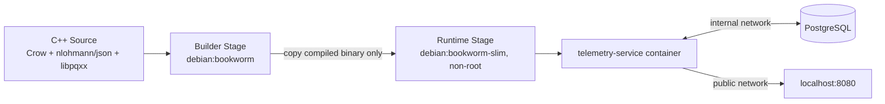
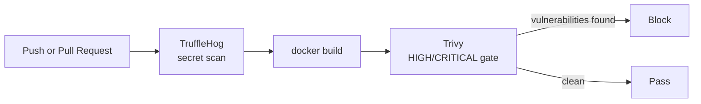

# IoT Telemetry Service

**A memory-safe C++ backend for ingesting IoT device telemetry — containerized, network-isolated, and continuously verified by an automated DevSecOps pipeline.**


---

## Overview

This service accepts IoT sensor readings over HTTP, validates them, and persists them to PostgreSQL. It's built with [Crow](https://crowcpp.org/) (HTTP), [nlohmann/json](https://github.com/nlohmann/json) (validation), and [libpqxx](https://github.com/jtv/libpqxx) (database access).

What makes this project worth reading, though, isn't the telemetry endpoint itself — it's everything wrapped around it. Every layer was built with security as a design constraint, not a bolt-on: a multi-stage build that ships zero compiler tooling, a container that runs as an unprivileged user on a network-isolated backend, and a CI/CD pipeline that scans every single commit for leaked secrets and CVEs before it can reach `main`.

## Table of Contents

- [Architecture](#architecture)
- [Tech Stack](#tech-stack)
- [Security Features](#security-features)
- [API Reference](#api-reference)
- [Project Structure](#project-structure)
- [Local Setup](#local-setup)
- [Running Security Scans Locally](#running-security-scans-locally)

---

## Architecture

The system is built in four distinct layers, each one narrowing what the next layer is allowed to trust.





| Layer | Lives in | Responsibility |
|---|---|---|
| **Application** | `src/`, `include/` | HTTP routing, JSON validation, database access |
| **Build** | `Dockerfile` (builder stage) | Compiles the binary; never ships |
| **Container / Orchestration** | `Dockerfile` (runtime stage), `docker-compose.yml` | Runs the binary with minimal privilege, wires it to Postgres |
| **CI/CD** | `.github/workflows/security-scan.yml` | Re-verifies every layer above on every commit |

### Application layer

The C++ source is deliberately split so each piece can be reasoned about (and tested) independently:

- **`main.cpp`** — Crow routes (`GET /healthz`, `POST /api/v1/telemetry`) and the glue between validation, the connection pool, and the database insert.
- **`Config.hpp`** — Reads all configuration from environment variables and **throws at startup** if anything required is missing. The process never opens a listening socket with a bad or default credential.
- **`ConnectionPool.hpp`** — A small thread-safe RAII pool of `pqxx::connection`s. Crow serves requests from multiple worker threads, and a `pqxx::connection` isn't safe to share across threads — this hands each request its own connection and guarantees it's returned even if the request throws.
- **`TelemetryPayload.hpp`** — Validates every field's presence, type, and physical plausibility (e.g. latitude within ±90°) before anything touches SQL. Has zero dependency on Crow or libpqxx, so it's trivially unit-testable in isolation.

### Build layer: multi-stage compilation

The `Dockerfile` has two stages that never touch each other's contents beyond one explicit `COPY`:

```dockerfile
FROM debian:bookworm AS builder      # full compiler toolchain
# ... cmake, git, build-essential, libpq-dev, libasio-dev ...
# ... CMake FetchContent pulls pinned versions of Crow, nlohmann/json, libpqxx ...
# ... compiles + strips the binary ...

FROM debian:bookworm-slim AS runtime  # nothing from the line above
COPY --from=builder /build/build/telemetry_service ./telemetry_service
```

Builder and runtime are pinned to the **same Debian release** on purpose — mixing distro families (e.g. an Ubuntu builder with a Debian runtime) risks a glibc version mismatch that crashes the binary at container startup with a cryptic `GLIBC_2.NN not found` error. Same release, same C library ABI, guaranteed compatible.

### Container layer: docker-compose

Two services, two networks:

| Service | Image | Network(s) | Exposed to host? |
|---|---|---|---|
| `telemetry-service` | built from local `Dockerfile` | `public`, `backend` | Yes — port 8080 |
| `db` | `postgres:16-alpine` | `backend` only | **No** |

The `backend` network is marked `internal: true` — it has no route to the outside world. `db` has no `ports:` entry at all. The database is reachable *only* from the app container, over a network that itself can't reach the internet.

### CI/CD layer

`.github/workflows/security-scan.yml` runs the same two gates automatically, on every pull request and every push to `main`. See [Security Features](#security-features) below for exactly what each gate checks.

---

## Tech Stack

| Component | Technology | Version |
|---|---|---|
| HTTP framework | [Crow](https://crowcpp.org/) | v1.3.4 |
| JSON validation | [nlohmann/json](https://github.com/nlohmann/json) | v3.12.0 |
| PostgreSQL client | [libpqxx](https://github.com/jtv/libpqxx) | 7.10.7 (C++17 line — see note in `CMakeLists.txt`) |
| Database | PostgreSQL | 16 (Alpine) |
| Language standard | C++ | 17 |
| Build system | CMake | 3.16+ |
| Container runtime | Docker / Docker Compose | — |
| Secret scanning | [TruffleHog](https://github.com/trufflesecurity/trufflehog) | 3.x |
| Vulnerability scanning | [Trivy](https://trivy.dev/) | pinned via CI (see below) |
| CI/CD | GitHub Actions | — |

---

## Security Features

### Attack-surface reduction via multi-stage build

The image that's actually exposed to the network carries almost none of the tooling used to build it:

| | Builder stage | Runtime stage |
|---|---|---|
| Base image | `debian:bookworm` | `debian:bookworm-slim` |
| Compiler / build tools | gcc, g++, cmake, git, make (~87 packages) | **none** |
| Source code | Full tree | **none** |
| Installed packages | Full C++ toolchain + headers | `libpq5`, `ca-certificates`, `bash` only |
| What ships | Nothing — discarded after build | Just the stripped binary |

If the running container is ever compromised, there's no compiler on hand to build further exploit tooling in place, no source tree to leak, and a dramatically smaller package surface for CVEs to accumulate against. The binary itself is stripped of debug symbols during the build (`strip build/telemetry_service`) to reduce both image size and the information handed to anyone who obtains a copy.

### Non-root execution

- A dedicated system user (`telemetry`) owns and runs the process — no login shell (`/usr/sbin/nologin`), no password, no home directory.
- The binary and health-check script are `chmod 550` (owner and group can read/execute; no write access for anyone, no access at all for others).
- `USER telemetry` drops privileges *before* `ENTRYPOINT` runs.
- At the orchestration level, `docker-compose.yml` adds further defense in depth: `cap_drop: [ALL]` (zero Linux capabilities — this service does no privileged binding or raw networking), `security_opt: no-new-privileges:true`, and a **read-only root filesystem** (the container can't write to its own image layer at all).

### Secret scanning

Two layers, same underlying tool:

- **Locally (`scan.sh`)** — a pre-push gate that scans the working directory with TruffleHog before you ever push. Vendored build dependencies (`build/`) are explicitly excluded from the scan (`.trufflehog-exclude.txt`) — scanning a third-party library's own git history for "your" secrets is pure noise and a source of false positives.
- **In CI** — TruffleHog runs on every PR and push, scanning the *actual commit diff* (correct `base`/`head` refs are chosen per event type, since using the wrong ref pair causes TruffleHog to silently scan nothing).
- `--results=verified,unknown` is used in both places — this reports live-verified credentials **and** high-confidence matches TruffleHog couldn't actively verify (e.g. no network path to check them), not just the subset it could conclusively confirm.
- **Architectural backstop:** even if a scanner ever missed something, `Config.hpp` only ever reads secrets from environment variables — there is no code path in this project where a real credential could be hardcoded in the first place.

### CVE vulnerability gating

- Trivy scans the **actual built runtime image** — not source code, not the Dockerfile in the abstract, the real artifact that would ship.
- `--severity HIGH,CRITICAL` — only these two levels are reported or gated on; LOW/MEDIUM findings exist in the image but don't block anything.
- `--ignore-unfixed` — vulnerabilities with no available patch yet are excluded from the gate, so it reflects "is there something actionable right now," not "does a CVE exist somewhere with no fix."
- In CI, the official `aquasecurity/trivy-action` is pinned to a **specific commit SHA**, not a version tag — deliberately. In March 2026, a real supply-chain attack force-pushed 76 of 77 version tags of this exact action to credential-stealing malware ([GHSA-69fq-xp46-6x23](https://github.com/aquasecurity/trivy/security/advisories/GHSA-69fq-xp46-6x23)). The pinned commit corresponds to `v0.35.0`, the version explicitly named safe in the advisory — pinning to the commit itself means this workflow can't be silently repointed at a compromised release even if a tag were hijacked again.

### Additional hardening

- **SQL injection prevention** — every database write uses `pqxx::params` with bound parameters, never string concatenation. Verified directly: a `device_id` containing `"; DROP TABLE telemetry_readings;--"` was sent to the live endpoint and stored as an inert string, table intact.
- **Compiler hardening** — `-Wall -Wextra -Wpedantic -fstack-protector-strong`, plus `_FORTIFY_SOURCE=2` in Release builds.
- **Dependency-free health checks** — the container health check uses bash's built-in `/dev/tcp` to make a real HTTP request, rather than installing `curl`/`wget` into the minimal runtime image purely for that purpose.
- **Least-privilege CI permissions** — the GitHub Actions workflow declares `permissions: contents: read` explicitly; it has no ability to write packages, comment on PRs, or touch anything beyond reading the repo.

---

## API Reference

| Method | Path | Description | Success |
|---|---|---|---|
| `GET` | `/healthz` | Liveness check | `200` `{"status":"ok"}` |
| `POST` | `/api/v1/telemetry` | Submit a telemetry reading | `201` `{"status":"accepted","device_id":"..."}` |

**Example request:**

```bash
curl -X POST http://localhost:8080/api/v1/telemetry \
  -H "Content-Type: application/json" \
  -d '{
    "device_id": "sensor-001",
    "timestamp": "2026-09-09T12:34:56Z",
    "temperature": 23.5,
    "location": { "lat": 40.7128, "lon": -74.0060 }
  }'
```

Malformed JSON or a failed validation rule (missing field, wrong type, out-of-range coordinate) returns `400` with `{"error": "..."}` describing the first problem found.

---

## Project Structure

```
.
├── .github/workflows/security-scan.yml  # CI: TruffleHog + Trivy on every PR/push
├── src/main.cpp                         # HTTP routes, wiring, DB insert
├── include/
│   ├── Config.hpp                       # Env-var config, fail-fast
│   ├── ConnectionPool.hpp               # Thread-safe RAII pqxx pool
│   └── TelemetryPayload.hpp             # JSON validation, framework-independent
├── sql/schema.sql                       # telemetry_readings table + index
├── Dockerfile                           # Multi-stage: builder -> minimal runtime
├── docker-compose.yml                   # App + Postgres, isolated networks, health checks
├── healthcheck.sh                       # Dependency-free bash /dev/tcp health probe
├── scan.sh                              # Local pre-push security gate
├── .trufflehog-exclude.txt              # Vendored-dependency exclusions for secret scanning
├── CMakeLists.txt                       # FetchContent-based build, pinned dependency versions
└── .env.example                         # Documents required environment variables
```

---

## Local Setup

**Prerequisite:** [Docker Desktop](https://www.docker.com/products/docker-desktop/) installed and running.

```bash
# 1. Clone the repository
git clone https://github.com/Soakar2/iot-telemetry-service.git
cd iot-telemetry-service

# 2. Configure environment variables
cp .env.example .env
# edit .env: set real values for DB_NAME, DB_USER, DB_PASSWORD

# 3. Build and start everything
docker compose up --build
```

This builds the multi-stage image and starts both containers — Postgres (schema auto-applied from `sql/schema.sql`, no port published to the host) and the telemetry service (published on `http://localhost:8080`).

**Verify it's running:**

```bash
curl http://localhost:8080/healthz

curl -X POST http://localhost:8080/api/v1/telemetry \
  -H "Content-Type: application/json" \
  -d '{"device_id":"sensor-001","timestamp":"2026-09-09T12:34:56Z","temperature":23.5,"location":{"lat":40.7128,"lon":-74.0060}}'
```

You should see `{"status":"ok"}` from the first call and a `201` with `{"status":"accepted",...}` from the second.

**Shut everything down:**

```bash
docker compose down          # stop and remove containers
docker compose down -v       # also wipe the Postgres data volume
```

---

## Running Security Scans Locally

`scan.sh` runs the exact same two gates as CI, before you push:

```bash
chmod +x scan.sh   # first time only
./scan.sh
```

It checks that Trivy and TruffleHog are installed (printing install instructions if not), scans the working directory for secrets, builds the Docker image, and scans it for HIGH/CRITICAL CVEs. Exit code `0` means every gate passed. See the comments inside `scan.sh` for the reasoning behind each specific flag and threshold.
